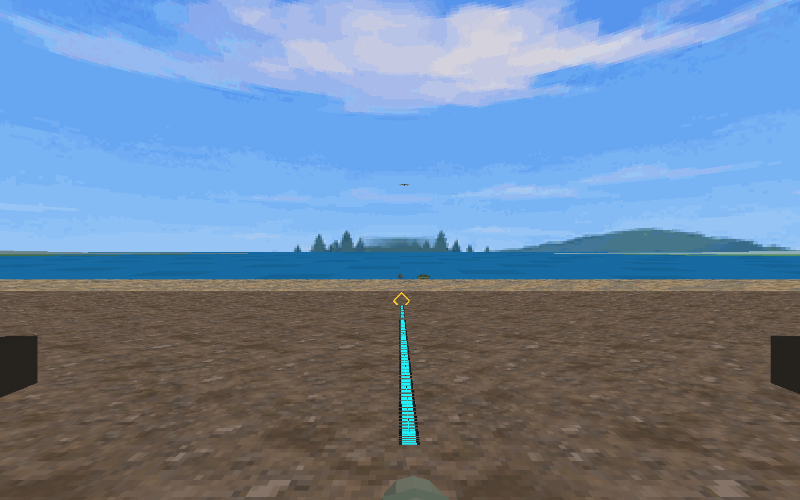

# Breakwater visible trajectory and crisp horizon — actual native renderer

**Project:** breakwater | **Source:** `94b9c1e969abd59b6455b27533e460fd331a06cc` | **License:** Project-origin code and approved archived panorama assets; existing licenses retained

**Asset provenance:** Actual Mesa GLES native game capture with live aiming input and a controlled mixed-fleet fixture; not an installed APK or headset capture.
This is an actual game-module render on Mesa with live aiming input and a controlled mixed-fleet fixture. It is not an installed APK or physical headset capture.

The cyan trajectory shares the weapon ballistics and ends at the first contact diamond. The archived 1024px panorama is sampled without blur filtering. Models and mounts remain unfinished.

### trajectory-horizon.png

