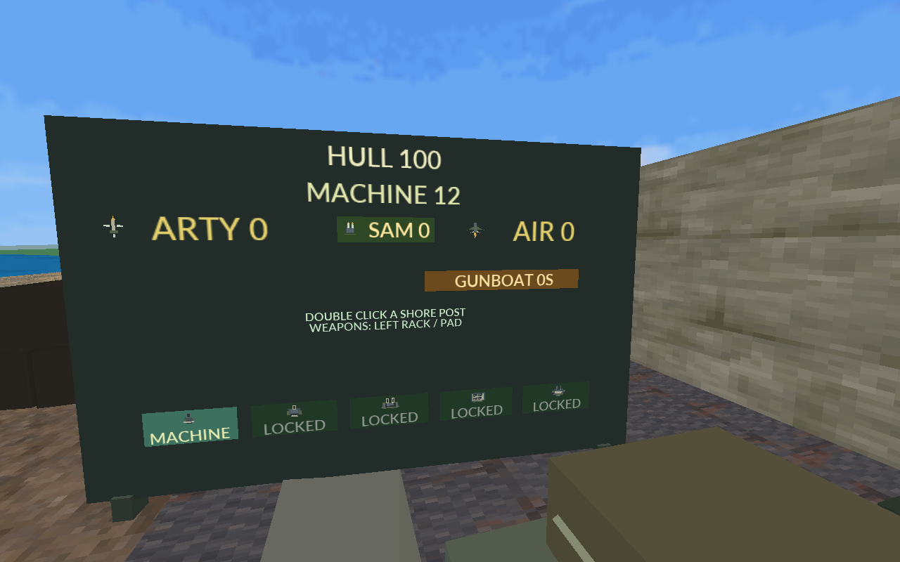
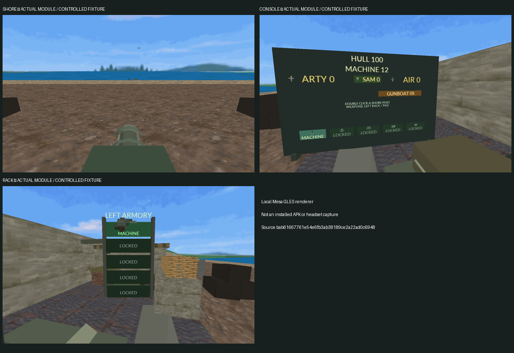
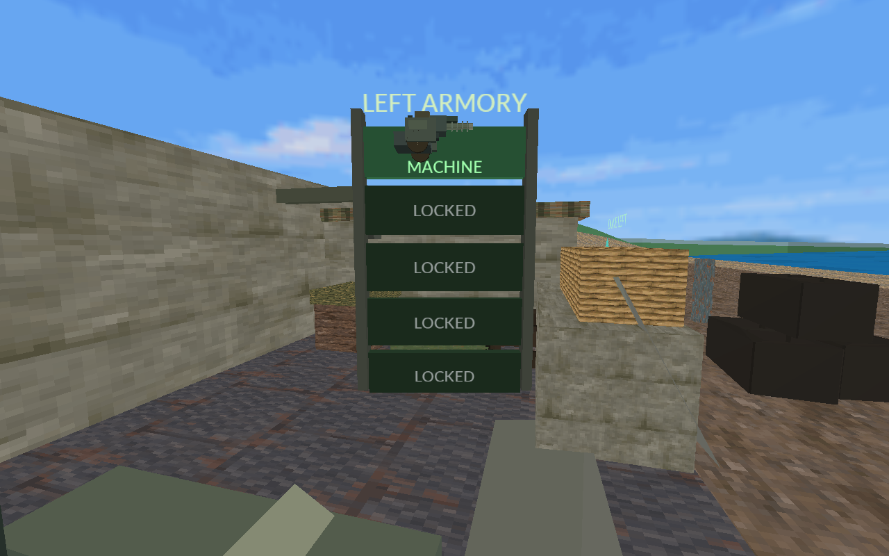
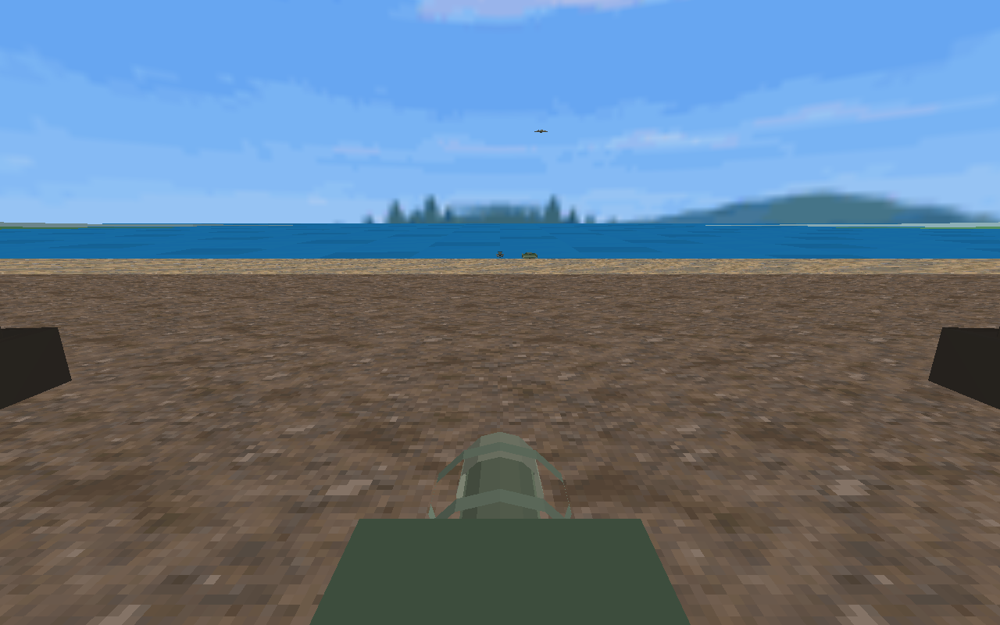

# Breakwater coastal rebuild — actual native module captures

**Project:** breakwater | **Source:** `066c4e5779a0da7db642b79808aa53fc331733a7` | **License:** Project-origin code and approved packaged game assets; existing asset licenses retained

**Asset provenance:** Actual native Breakwater GLES renderer on Mesa; controlled mixed-fleet fixture; not installed APK or headset captures.
These are actual native-module renders on a Mesa software GLES driver using a controlled mixed-fleet fixture. They are not installed-APK or physical-headset captures.

Publication is authorized. The captures were rendered from reviewed local commit `bab61667761e54e6fb3ab38189ce2a22ad0c6948`, whose complete source tree exactly matches published source `066c4e5779a0da7db642b79808aa53fc331733a7`. The contact image retains the local capture revision label.

### console.png

### contact.png

### rack.png

### shore.png

