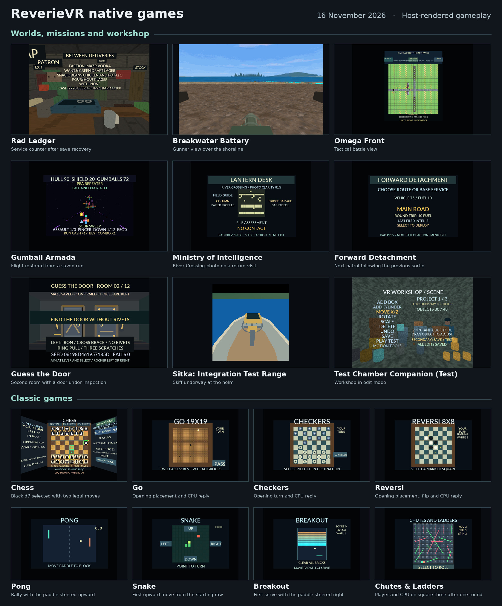

# Daydream native games · November 16, 2026

All 17 registered games were exercised in the unified ReverieVR codebase. Eight entries use Development mode in the launcher. The other nine appear in Standard mode. The registry check matched every Java entry to its native ID, content namespace and Android build target. DOOM runs in the DOS host and has its own control and acceptance path.

[Download the signed headset APK, Phone Test #2026](https://github.com/mrcalzon02/ReverieVR/releases/download/phone-test-2026-1/ReverieVR-phone-test-2026-6e07e27.apk) · [Release notes and checksums](https://github.com/mrcalzon02/ReverieVR/releases/tag/phone-test-2026-1)

The headset build has Android version code `217031946`. Its SHA-256 is `129c0922d6714876e9fc40bf01aa036ccb4a48d5af690a378f60adfa187dcfc1`. It contains the 17 bundled game libraries for both 32-bit and 64-bit ARM.



The table links to original-resolution gameplay pixels. These are production game modules running on a desktop Mesa host. The controls, saves, geometry and text come from the games. Physical Daydream controller feel, optical readability and sustained Galaxy S9 frame pacing require a headset run. The November 8 audit records older defects and the full intended scope. The entries below describe the new checkpoint. [Game source](https://github.com/mrcalzon02/ReverieVR/commit/6e07e2791f44f92c1cd0b8388b6863e760497c03) · [Original scope and audit](../../../records/2026-11-08-native-games-release-audit.md) · [Capture provenance and SHA-256](gallery.json)

| Title and frame | What ran and what changed | Next playable acceptance |
| --- | --- | --- |
| [Sitka](sitka.png) | Walked from spawn, aimed a cast with Android-shaped hand coordinates, boarded, drove, coasted and docked. Both eyes now travel with the helm and shore movement leaves the rudder centered. The chart uses the source elevation shading and depth range needed to see its real NOAA/USGS tiles. | Build a walkable geographic harbor with placed beach and town discoveries. The current fishing range has one desk, one fishing spot and one berth. Additional discovery-gated gear and vessel tiers need earnable finds. |
| [Breakwater Battery](breakwater-battery.png) | Difficulty selection consumes the input that opens the shop. A shot fired on the defeat frame can no longer arm campaign deletion. Exercised shop, combat, sound, checkpoint recovery, three stations, trajectory and context recreation. | Play all four theaters through the APK, including the five weapon selections, sight/impact agreement and debrief/reopen. Coastal models and mounts still need a visual pass. |
| [Omega Front](omega-front.png) | A failed campaign read now offers Retry. Opening New Campaign requires explicit erase confirmation. Exercised travel, deployment, orders, tactical turn, failed writes and exact tactical-state restoration. | Play all six authored Hearthfall operations through their real aftermath screens. The 600-cell continental view still leads into the same 16-sector region. |
| [Gumball Armada](gumball-armada.png) | Ordinary hostile shots now intersect the ship's flight plane beyond the launch row. Verified interception and dodging at four heights, ship construction and active-flight restoration with paid escort support. | Play and author beyond the four fortress flags. The campaign still returns to the chart with the king missing. Rescue, ending and credits remain open. |
| [Red Ledger](between-deliveries-red-ledger.png) | A held Select toggled a bar action twice across Pause/Resume. The production-module regression now takes a cup once, holds it through resume and returns it on a fresh press. A rejected payment save recovered to 2,480 cents with nothing left to collect. | Follow a saved shift from supply purchase through closing accounts. The opening economy works. The month-by-month faction story and its endings are unfinished. |
| [Lantern Desk](ministry-lantern-desk.png) | Three sectors now each have two photographic conditions. A return to River Crossing can show an intact deck after a damaged one. The evidence, grade and sector progression survive recreation. The field guide gives the same silhouette cues for every assignment. | Add photograph magnification, evidence marking and comparison on the seated desk. The six deterministic cases are the present playable content. |
| [Forward Detachment](iron-sight-forward-detachment.png) | Last filed intelligence persists independently for each route and appears when planning the next patrol. Verified explicit refit, low-fuel refusal, save failures, both route logs and restoration. | Connect the briefing, observations and debrief to a traversable sector and vehicle. Both routes currently play on a decision board. |
| [Guess the Door](guess-the-door.png) | A tracked ray aimed away from both levers now leaves them alone. Off-target Select also leaves recovery choices alone. Replayed a seeded safe choice, walked through the first door and inspected the next clue. | Validate the 12-room run, pit replay, clue legibility and lever targeting in the headset. |
| [Test Chamber](procedural-test-chamber.png) | Opened the bundled scene in Edit mode and rendered both eyes. Workshop tests covered transforms, undo, slots, lighting, motion and sound. A bad first slot could recover a valid alternative. Dirty writes could be retried before exit. | Author, save, reopen and play one complete scene through the physical controller, including light, motion and spatial sound. |
| [Chess](classic-chess.png) | Black's pad cursor now selects and outlines the same logical square with a live gaze ray. White's CPU played its opening move, then Black selected d7 and saw two legal destinations. The piece label clears the back rank. The rules matched 20 reference move-tree counts. | Finish a match from each orientation and exercise promotion, castling and draw handling with live input. A new move-legality defect was not reproduced. |
| [Go](classic-go.png) | Placed a stone with the highlighted pad cursor while a ray remained live. The CPU replied. Recreated a match with the pending CPU turn and tested checkpoint retry. | Play two passes into scoring and settle dead groups using the shipped controls. |
| [Checkers](classic-checkers.png) | The visible pad square now owns Select until deliberate pointing takes over. A player move and CPU reply rendered and a pending CPU turn survived recreation. | Play forced captures, multi-jumps, promotion and draw claims through an interrupted match. |
| [Reversi](classic-reversi.png) | Verified a player placement, disc flip and CPU response. Pad highlighting and activation agree with a live headset ray. | Play a forced pass and a final score through the hosted UI, then replay or reopen. |
| [Pong](classic-pong.png) | Served and moved the paddle with the pad. A stationary gaze ray no longer snaps the paddle back after release. Deliberate pointing takes control again. | Finish a scored match and verify serve, pause and replay with the physical controller. |
| [Snake](classic-snake.png) | Started upward from cell 77 to 65 through the native controls. Exercised pause, rearm, recreation and storage errors. | Test the visible four-way targets at headset scale through collision, restart and a longer run. |
| [Breakout](classic-breakout.png) | Served and moved the paddle right through the pad. It retains its new position until the ray moves deliberately. Verified lifecycle and save recovery. | Clear both walls and exercise life loss, a resume between serves and the final replay prompt in the hosted game. |
| [Chutes & Ladders](classic-chutes-ladders.png) | The player and CPU rolled, both reached square three, and the module passed recreation and retry checks. | Follow a full match through a chute, ladder, exact-finish overshoot and winner/replay. Check that the roll and destination remain legible. |

### Two changes visible in play

The geographic inspector is separate from Sitka's synthetic game range. Its stereo render uses the staged source land tiles and Android-shaped projection. The CI result contains 29,704 land pixels in the sampled lower half of the left eye and 30,194 in the right. Omega's recovery screen offers to reload the existing save before a replacement can be confirmed. [Sitka chart stereo pair](sitka-chart-land.png) · [Omega recovery screen](omega-campaign-recovery.png)

### Verification

GCC host diagnostics passed 25 Omega programs, 12 Gumball programs, 2,490 Breakwater control/audio assertions and 25,386 classic save-codec assertions. The Sitka runner passed 39 checks and the final shaded chart passed an independent remote render. Eight classic modules and Guess the Door were replayed at the integrated game commit. All 18 eye images reproduced pixel for pixel. The shell binding suite passed 41 JUnit tests, 27 Java runtime assertions using a counting JNI double, and 22 native-host save/exit assertions. [All 10 functional jobs](https://github.com/mrcalzon02/ReverieVR/actions/runs/43971205599) · [All nine content and package jobs](https://github.com/mrcalzon02/ReverieVR/actions/runs/43971205966) · [Independent chart render](https://github.com/mrcalzon02/ReverieVR/actions/runs/43971205683)

The Android 10 archive launched all 17 registry IDs, captured a 512 × 512 GLES2 image for each and passed both instrumentation tests. All 17 downloaded images independently passed the repository verifier. A separate Android recovery run completed a same-signer app upgrade with saved state, a 5,000-frame gaze simulation and module rollback. [Installed Android archive](https://github.com/mrcalzon02/ReverieVR/actions/runs/43971205702/artifacts/14278328944) · [Upgrade and rollback evidence](https://github.com/mrcalzon02/ReverieVR/actions/runs/43971205937/artifacts/14280180630)

The broader installed-hub suite passed all 14 instrumentation tests on the same source. The first attempt stopped during Red Ledger when the emulator's Android system server exhausted its 16 MiB growth limit. A fresh emulator passed the complete suite with the same APK source and assertions. The separate Breakwater packaging job recovered from a Gradle plugin-resolution failure on retry. All eight workflows on the game commit finished successfully. The published headset APK was downloaded and rechecked against the release digest, both ARM ABIs and all 36 host/module ELF binaries. [Installed-hub run, successful attempt](https://github.com/mrcalzon02/ReverieVR/actions/runs/43971205706/attempts/2) · [Installed-hub diagnostic artifact](https://github.com/mrcalzon02/ReverieVR/actions/runs/43971205706/artifacts/14279532156) · [Signed phone build](https://github.com/mrcalzon02/ReverieVR/actions/runs/43971205737)

### Replaying the host checks

From the source root, the existing runners exercise real production entry points with the host's C++17 compiler, EGL/GLES and zlib. The output directories retain the frames used by the recon, campaign and save-recovery tests.

```sh
export EGL_PLATFORM=surfaceless LIBGL_ALWAYS_SOFTWARE=1
out=$(mktemp -d)
bash scripts/verify-recon-persistence.sh --gles "$out/recon"
bash scripts/verify-featured-persistence.sh "$out/featured"
bash scripts/verify-omega-repairs.sh "$out/omega"
bash scripts/verify-classic-saves.sh
bash scripts/verify-recent-game-persistence.sh
python3 scripts/sitka/verify_gameplay.py --render
```

The two gallery drivers preserve the progressed-state camera and the actual input sequences for the classics, Guess the Door and Test Chamber. The door fixture starts at room one with the original audit seed. The comparison records the two eyes separately. [Per-eye comparison](replay/stereo-comparison.json)

```sh
out=$(mktemp -d)
proof=docs/gallery/native-games/2026-11-16/replay
for kind in 0 1 2 3 4 5 6 7 doors; do
  flag="-DCLASSIC_GAME_KIND=$kind"
  if [ "$kind" = doors ]; then flag="-DDOORS"; fi
  c++ -O1 -std=c++17 -pthread -Iscripts/audit/probes -Iapp/src/main/jni/native \
    "$flag" "$proof/classic_or_door.cpp" -lEGL -lGLESv2 -lz -o "$out/play"
  EGL_PLATFORM=surfaceless LIBGL_ALWAYS_SOFTWARE=1 "$out/play" "$out" || exit 1
done
c++ -O1 -std=c++17 -Iapp/src/main/jni/native -Iapp/src/test/native \
  -Ithird_party/openktg/src "$proof/workshop.cpp" third_party/openktg/src/gentexture.cpp \
  -lEGL -lGLESv2 -lz -o "$out/workshop"
EGL_PLATFORM=surfaceless LIBGL_ALWAYS_SOFTWARE=1 "$out/workshop" "$out"
```
