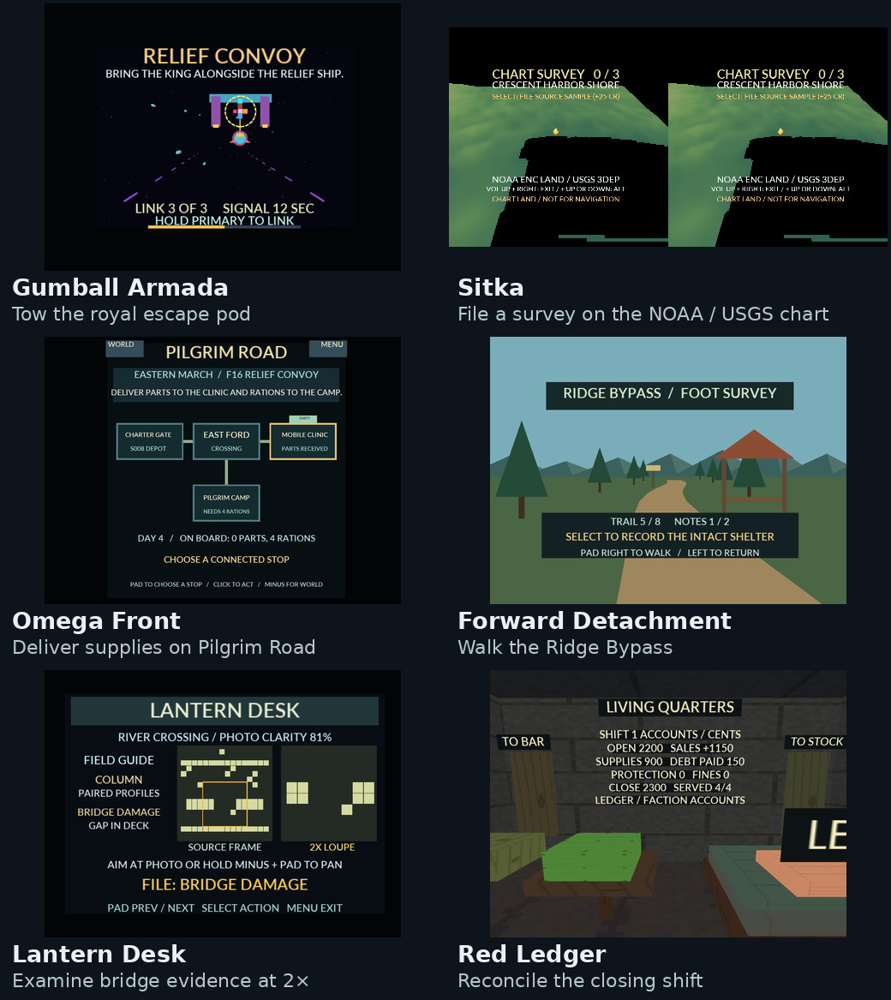

# Daydream native games · Campaigns, fieldwork and match endings

**[Download the signed headset APK, Phone Test #2028](https://github.com/mrcalzon02/ReverieVR/releases/download/phone-test-2028-1/ReverieVR-phone-test-2028-2ad191b.apk)** · [Release notes and checksums](https://github.com/mrcalzon02/ReverieVR/releases/tag/phone-test-2028-1)

The November 16 development pass covered all 17 native games registered in ReverieVR. Fourteen received player-facing changes. Checkers, Guess the Door and Breakwater Battery were exercised against the same source. The previous gallery records the opening states. This one follows saves and controls into later play. [Game source](https://github.com/mrcalzon02/ReverieVR/commit/2ad191b58e2060fa365aaf6bf40b3ad04efdadc0) · [Previous audit](../README.md) · [Intended scope by title](../../../../records/2026-11-08-native-games-release-audit.md)



## Campaigns and authored activities

| Game | What a player can do in this build | Remaining work |
| --- | --- | --- |
| [Gumball Armada](gumball-rescue.webp) | After all four generals, take the center Crown Route, trace the signal relay, attach the drifting pod and tow the king to the moving convoy. A lost signal can be retried. Homecoming leads to credits and saved free flight. The fresh simulation campaign reached the ending in 67 sorties, with 61 wins. A separate GLES run opened a four-fortress save from the previous build, interrupted the tow, recovered a failed save, and continued through credits. [Homecoming](gumball-homecoming.webp) | Distinct regional bosses, finale audio and physical-controller balance. |
| [Sitka](sitka-survey.webp) | On the NOAA/USGS chart, navigate to three measured terrain vertices and file each once for 25 credits. From shore, use Volume Up with pad-right to open the survey. In the fictional practice bay, walk the circuit, identify 12 modeled specimens, visit six checkpoints and register the finds at the office. Two line upgrades were actually purchased. Existing V5 journals import to V6. [Practice shore](sitka-shore.webp) | Walking, fishing and boating still use the practice bay. A verified geographic berth and shore-fishing route remain open. |
| [Omega Front](omega-clinic.webp) | Dispatch from Charter Gate, cross East Ford, deliver parts to Mobile Clinic and rations to Pilgrim Camp in either order. Marches advance the strategic day. Returning to the gate files the manifest and grants credit once. The tested trip finished on day 8. A mid-trip save restored identical stereo views. | This opens three cells beyond the 16 Hearthfall sectors. Other continental cells, faction arcs and full Hearthfall aftermath playthroughs remain open. |
| [Red Ledger](red-ledger-accounts.webp) | Buy stock, return to the bar, serve all four opening patrons, wash a cup, collect each payment and close the day at the bed. The ledger now shows opening cash, sales, purchases, debt service, fees and closing cash. Tested amounts in cents were 2,200 opening + 1,150 sales − 900 stock − 150 debt = 2,300 closing. The accounts reopened in the living quarters. In a 135-day simulation, the last installment was 50 cents and the following day's charge was zero. | The continuing faction, property and calendar story still needs authored consequences and endings. |
| [Lantern Desk](lantern-loupe.webp) | Keep the original photograph and the assessment controls visible while inspecting any 8×8 region at 2×. Aim at the film or hold Minus and use the pad. The test matched all 64 loupe-cell centers to the source image. The view survived pause and GL recreation. A new launch restores the evidence with the loupe centered. | Persistent annotations, photo-to-photo comparison and additional cases. |
| [Forward Detachment](forward-trail.webp) | Walk Ridge Bypass, backtrack to the stream gauge or shelter, record observations, and carry the notes to civilian contact and debrief. On the same peaceful decision, the filed report earned six intelligence with both observations and two with neither. Position and notes survived relaunch and failed-write retry. | Main Road still plays on the briefing board. Vehicle traversal and additional outdoor sectors remain open. |
| [Test Chamber](test-chamber-scene.webp) | Select a blank project from the first editor page, place and move two primitives, attach lighting, motion and spatial sound, save, exit and reopen the same slot in Play. The prior build reopened the bundled showcase after saving slot two. The new run restored the custom scene and verified moving geometry and stereo sound gains. | Physical controller authoring, emitted sound on the handset and optical readability. |
| [Breakwater Battery](breakwater.webp) | Rechecked the current campaign persistence and input recovery plus three stations, both eyes and GL context loss. The pictured shore comes from the production renderer and a controlled campaign state. | A continuous four-theater campaign through the APK and sustained device testing. |
| [Guess the Door](guess-the-door.webp) | Matched the posted clue to the physical door attributes, deliberately took a pit, replayed the original seed, reopened after room six, cleared all 12 rooms, reopened Victory, and started a fresh seed. | Headset clue timing and lever targeting, plus the outstanding art and speech work. |

## Classic match results

All eight replays used the compiled game module, controller inputs, the normal CPU where applicable, the module's save callback and the Continue prompt after recreation. The runs used a desktop Mesa GLES driver. The automated player could read board coordinates and rules. These results establish reachability and persistence. Physical difficulty and comfort still require players in the headset.

| Game | Observed result | Next check |
| --- | --- | --- |
| [Chess](chess.webp) | Played White to a Black win in 50 plies, then Black to a draw in 29. In both orientations the finished match reopened and the right-panel Restart button started a new game. Previously that button opened the reference book. | Promotion and castling through the physical controller in both orientations. |
| [Go](go.webp) | Two human stones and two CPU replies, two passes, mark and unmark a connected pair, reopen with the marks, resume play, return to review, accept 2–9.5 and restart. The live area score includes White's 7.5 komi. | Dense-board selection and longer contested scoring reviews in the headset. |
| [Checkers](checkers.webp) | Played 42 plies with five human captures, reopened after a capture, reached a CPU win and restarted. | A controller-driven multi-jump crossing an interrupted turn, plus promotion and draw claims. |
| [Reversi](reversi.webp) | Four complete 60-move matches covered a forced pass and both winners, including a 37–27 human win. The pass message now names who passed. Final totals survived reopening. | Legal-marker contrast and forced-pass readability through the optics. |
| [Pong](pong.webp) | The CPU won 11–0. The display identifies each score and the winner. Reopening retained the result and replay waited for a new serve. | Physical paddle tracking, close rallies and restart behavior. |
| [Snake](snake.webp) | Started through the visible Up target, hit the top wall, reopened the terminal state and restarted. The terminal message distinguishes Game Over from clearing the board. | A long food-collection run and self-collision using the physical directional targets. |
| [Breakout](breakout.webp) | Fixed unreachable edge rebounds when the paddle narrows. Lost a life, reopened between serves, cleared both 112-brick walls, reopened the 896-point victory with two lives and restarted. | Sustained physical paddle control through the second wall. |
| [Chutes & Ladders](chutes-ladders.webp) | Two matches and 69 human rolls covered a shared tile, chutes, ladders, an exact-finish overshoot, both winners and replay. Each side now retains its last roll and path. A previous-release checkpoint kept the next CPU roll, and new saves restore both roll histories. | Label and endpoint readability through the optics. |

## Evidence and replay

The per-title WebP files preserve the source RGB pixels losslessly. The overview is a captioned JPEG. The manifest contains original capture names, dimensions and decoded RGB SHA-256 hashes. Most views are from the left eye. Sitka's geographic frame includes both eyes. [Frame manifest](frames.json)

From the game-source checkout on a C++17 host with EGL, GLES2 and zlib, these commands replay the classic endings and the full maze. The fresh simulation campaign, checkpoint imports and module-level interruptions have separate runners.

```sh
export EGL_PLATFORM=surfaceless LIBGL_ALWAYS_SOFTWARE=1
out=$(mktemp -d)
for kind in 0 1 2 3 4 5 6 7; do
    c++ -O2 -std=c++17 -pthread -DCLASSIC_GAME_KIND="$kind" \
        -Iscripts/audit/probes -Iapp/src/main/jni/native \
        scripts/audit/probes/classic_match_endings.cpp -lEGL -lGLESv2 -lz -o "$out/classic" &&
        "$out/classic" "$out" || exit 1
done
c++ -O1 -std=c++17 -Iscripts/audit/probes -Iapp/src/main/jni/native \
    scripts/audit/probes/guess_full_maze.cpp -lEGL -lGLESv2 -lz -o "$out/doors" &&
    "$out/doors" "$out"
bash scripts/verify-gumball-armada.sh
bash scripts/verify-featured-persistence.sh "$out/featured"
bash scripts/verify-omega-repairs.sh "$out/omega"
bash scripts/verify-recon-persistence.sh --gles "$out/recon"
bash scripts/verify-test-chamber-authoring.sh "$out/chamber"
python3 scripts/sitka/verify_gameplay.py --render
```

## Installed Android evidence

On source `2ad191b58e2060fa365aaf6bf40b3ad04efdadc0`, the Android 10 menu archive passed two instrumentation tests and captured all 17 registered modules at 512 × 512. The downloaded ZIP matched SHA-256 `b51339670fd8ebdf39e4b3a74a3c2dc32dd2e559815a4a1e51fc3f380f5df293`. Its capture CSV and 17 PNGs also passed the repository's independent installed-frame verifier. The installed hub passed 14 instrumentation tests. A separate Android 10 run completed a same-signer upgrade with saved state, 5,000 gaze frames, all 17 menus and module rollback. [Android capture archive](https://github.com/mrcalzon02/ReverieVR/actions/runs/43979597848/artifacts/14282162764) · [Installed hub suite](https://github.com/mrcalzon02/ReverieVR/actions/runs/43979597818) · [Upgrade and rollback](https://github.com/mrcalzon02/ReverieVR/actions/runs/43979597912)

The independent Sitka job reproduced the gallery's Crescent Harbor survey PNG byte for byte. Its SHA-256 is `ac50206ce1f2d6d3c831b92c0bef5c7d3d87b3f0c92657ae69b7d8e4a38b6483`. The host suite passed all 39 Sitka checks, 25 Omega programs and 12 Gumball programs. The reference Galaxy S9, headset optics, audible speaker output, controller ergonomics and sustained thermal/frame pacing still need a physical session. [Geographic rendering](https://github.com/mrcalzon02/ReverieVR/actions/runs/43979597748) · [All-game functional diagnostics](https://github.com/mrcalzon02/ReverieVR/actions/runs/43979598095) · [Content and package contracts](https://github.com/mrcalzon02/ReverieVR/actions/runs/43979597826)

The phone-test tag resolves to the game source above. The published headset APK is 170,792,511 bytes, version code `217035230`, with SHA-256 `0996745205235f6b3ae3d39a2512031b7d8b7fbc2f57e6e895f51b0a58b0c573`. The download matched both GitHub’s asset digest and the published checksum file. Google’s APK signature verifier accepted both this build and Phone Test #2026 with the same certificate, SHA-256 `464dc2d100c3bb14deac1da680d29418cc22e60e1857852cb54541f7d7787f7c`. The ZIP integrity check, unified APK check and all 36 host/module ELF checks passed for the two ARM ABIs. [Signed build and publication](https://github.com/mrcalzon02/ReverieVR/actions/runs/43979597889)

The Gumball tow and homecoming frames and the closed-shift Red Ledger frame also reproduced pixel for pixel in both eyes with game assets extracted from this signed APK. Red Ledger used its built-in fallback for the 14 optional Beckenburg props and six optional patron meshes. Those art sets remain outstanding.
