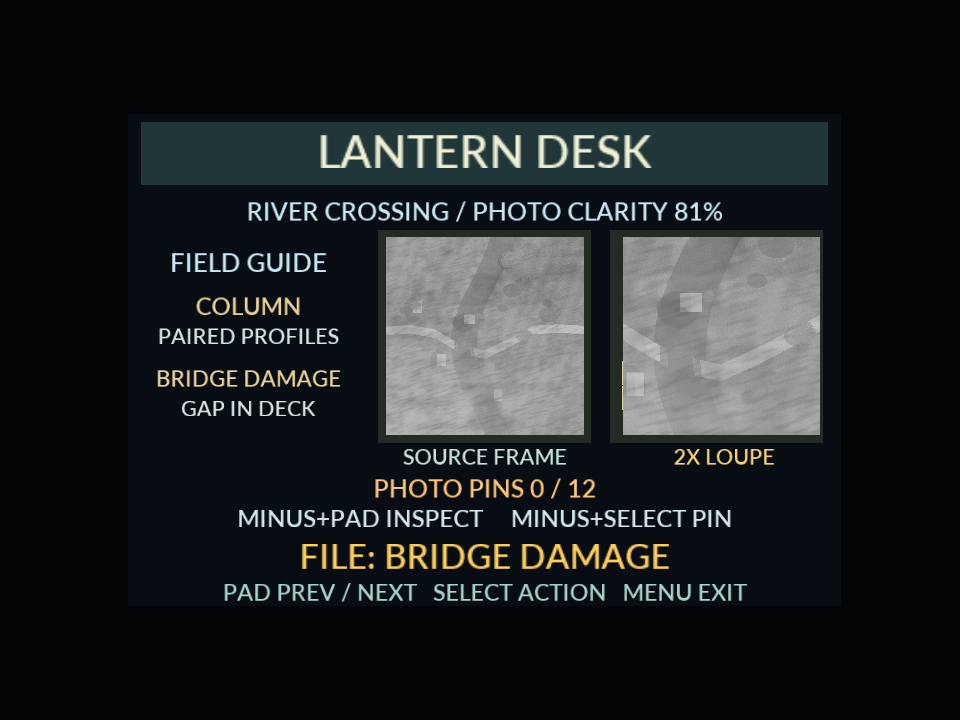
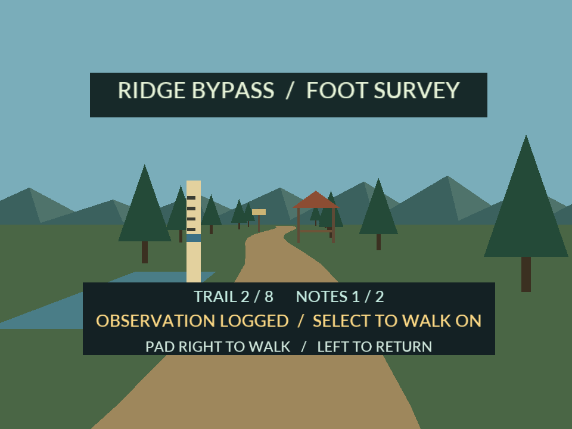
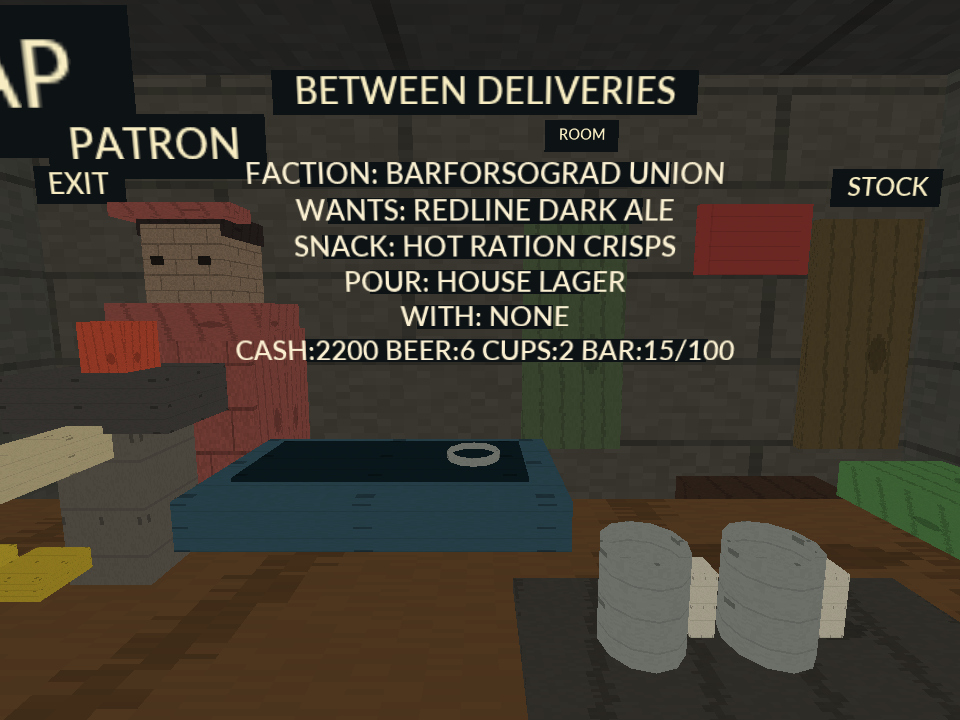
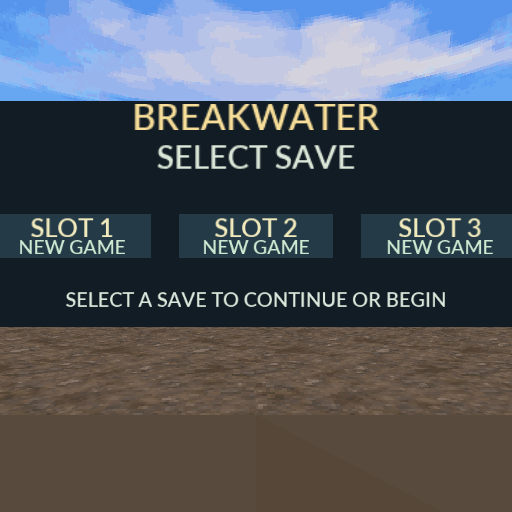
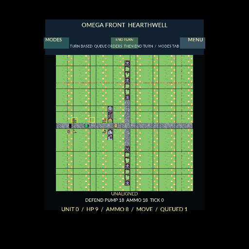

# Demo beta: actual native game frames — November 26, 2026

The host evidence below contains three unaltered **960 × 720 left-eye framebuffer captures** from the production native modules. These are real Mesa EGL/GLES renders, not concept images or physical-phone photographs. PNGs were losslessly converted from the test harness's PPM output, decoded and compared against the original RGB bytes; no resizing, cropping or image correction was applied. Two additional **512 × 512 installed-Android captures** follow, copied byte for byte from the successful recovery workflow artifact.

## Source and environment

- Published [Phone Test #2152](https://github.com/mrcalzon02/ReverieVR/releases/tag/phone-test-2152-1) source: `6afb9a9ae1115e5c84154fa539a44f167c28b51e`.
- Executed audit baseline: `532f128a291906c5a40a1d1bb3d48ce5fe7b6f44`.
- Native production tree in both revisions: `a53c86e4b5fbbd72107cee1aa9bc015e322726c5`. The selected test sources, native assets, third-party code and runner scripts are also unchanged between these revisions, verified with Git comparison.
- Host: x86_64 Linux, GCC 14.2.0, Mesa OpenGL ES 3.2 `25.0.7-2+deb13u1`; `EGL_PLATFORM=surfaceless`, `LIBGL_ALWAYS_SOFTWARE=1`. Existing production module sources run inside `app/src/test/native/featured_module_test_host.h`.

This establishes the captured gameplay states and tested recovery behavior. It does not establish physical Galaxy S9 controls/optics/audio or sustained device frame rate.

## Lantern Desk: photograph and loupe



Source capture: `recon/lantern-photo-before-left.png`. Test: `app/src/test/native/recon_module_save_test.cpp`, compiled with `RECON_PROJECT_KIND=0`; `Recreate(..., "lantern-photo")` captures the photo state before destroying/recreating the real module. The checkpoint and both eye frames are checked against the reopened state. The same run verifies the registered photo, loupe, annotations, focus recovery and report/save retries.

## Iron Sight: ridge survey



Source capture: `recon/forward-ridge-gauge-before-left.png`. Same test compiled with `RECON_PROJECT_KIND=1`; ordinary pad movement reaches trail position 2, Select records the gauge observation, and `Recreate(..., "forward-ridge-gauge")` verifies that saved trail progress and both eye frames survive module recreation.

Both recon variants were executed by:

```sh
bash scripts/verify-recon-persistence.sh --gles "$CAPTURE_DIR"
```

## Red Ledger: service and unpaid receipt recovery



Source capture: `featured/red-ledger-premium-owed-left.png`. Test: `app/src/test/native/red_ledger_module_save_test.cpp`, `PlayPremiumPendingReceipt`. A premium drink/snack is served through real pointer targets, the module is recreated, and stock plus the unpaid receipt must remain consistent. `audit::Capture(..., "red-ledger-premium-owed", ...)` records this reopened state; collection is then checked to pay exactly once.

Executed by:

```sh
bash scripts/verify-featured-persistence.sh "$CAPTURE_DIR"
```

Sitka's 40 native/rules/render checks also passed during this audit, but its temporary capture was cleaned up by the canonical runner. It is not substituted with an older image here.

## File integrity

Combined host PNG size: 471,417 bytes. SHA-256:

```text
df7a70101caa3f4bbe4b8daa724ae26fbdb51d7cad9a0eea1dbfa78b815b4116  lantern-desk-photo.png
fe1bce359b4157f138c2d0616a3d465464f7a460a1cb1cba0b35c33ccb22307a  iron-sight-ridge-survey.png
d9af15c98e87d87c93c2e03b8c82e91a20d9cfe9641cadfc86ad3ff7e64414e0  red-ledger-service.png
```

## Installed Android evidence

Source: `6afb9a9ae1115e5c84154fa539a44f167c28b51e`, the source of Phone Test beta #2152. [Android recovery workflow run 45895089160](https://github.com/mrcalzon02/ReverieVR/actions/runs/45895089160), artifact `15153278235`, completed successfully. The downloaded ZIP is 2,159,551 bytes, SHA-256 `3b48ffb309ad7d42a8d59a72cfaadea5131d3d4128bd923161ca0ebbfe9ed6ab`.

These frames were rendered by the installed application on an **Android 10/API 29 x86_64 emulator**, through the actual Java → JNI → C++ modules and a GLES2 pbuffer. The capture uses a fixed, zero-pitch, 80-degree square projection, renders both eyes with separate depth clears, and reads the completed final eye. These are original workflow PNGs with no image processing, resizing or cropping.

### Breakwater: initial save selection



Original artifact file: `native-menu-breakwater-battery.png`. Test: `DownloadedNativeGameAssetsInstrumentedTest.captureAllNativeMainMenus`. It starts each real native module, creates its GLES2 surface, performs a neutral update and saves the initial render. All 17 registered native games were captured; the test reports `OK (1 test)` and the CSV marks every entry `CAPTURED`. This frame establishes the visible save selection screen, not completion of a Breakwater battle.

### Omega Front: deployed tactical battle



Original artifact file: `native-omega-tactical.png`, collected from `omega-front-ci-tactical.png`. Test: `DownloadedNativeGameAssetsInstrumentedTest.omegaFrontReallyTravelsDeploysOrdersAndRestoresInGles`. Scripted input enters the campaign, opens the region, travels to sector 11, deploys at Hearthwell, selects a soldier and issues a movement order. This screenshot is taken after the order and native updates. The same successful test saves, pauses, releases/recreates the surface and module, resumes and continues the campaign, then verifies the checkpoint bytes and rendered CRC match the captured battle. The test reports `OK (1 test)`.

### Review and capture limits

All 17 native-menu PNGs were independently viewed, and their sizes/SHA-256 hashes match `capture-manifest.json`; all seven additional PNGs in that manifest also match. Every native menu is nonblank. Some side labels and lower help lines extend beyond the fixed square view in the classic games and Gumball; central boards and primary actions remain visible. These captures do not determine whether those elements remain outside view when a user turns their head. Sitka's initial capture shows a sparse scene with a standing colored marker and does not establish its geographic dock view.

The before/after upgrade screenshots also show the intact setup screen with version code changing from `182163200` to `182163800`. `verifyUpgradeSentinel` passes for real PackageManager in-place replacement and private preference/file preservation. This recovery run used the **debug signer**, not the production Phone Test signer. Controller events are scripted; it does not establish physical Daydream BLE, Galaxy S9 headset behavior, audio output or sustained frame rate. The downloaded artifact log has no `FATAL EXCEPTION`, `Fatal signal`, `ANR in`, instrumentation-failure or assertion-failure markers. This review did not run new tests or alter native code.

### Android file integrity

The two Android PNGs total 120,217 bytes; all five PNGs in this folder total 591,634 bytes. SHA-256:

```text
b2ec7b1c6fc3c7b591198667bcf802e1bdcd709e6c96d8ead63a75606ee626f8  android-breakwater-save-menu.png
4a8ed9ff71bc0011fc8f481d7bfbec45b5c14314242e5ebc1d6cdff32b25d37c  android-omega-tactical.png
```
