# Sitka boat progression — 18 physical turntables

**Development review • 2026-11-05 • All 18 real OBJ-based low-poly rough models**

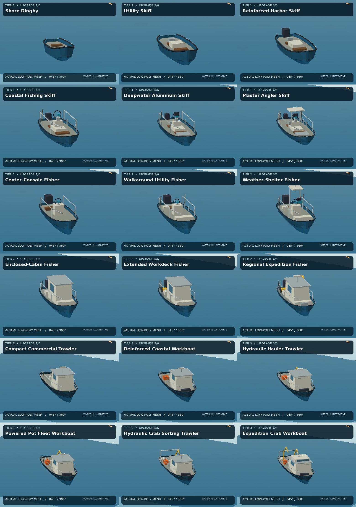

These images were rendered from actual triangulated OBJ models, **not generated concept-art guesses or playable-game screenshots**. Each full rotation comprises **24 views at 15° intervals**. The water plane is illustrative; no claims of certified Sitka tide depths, float stability, licensed geocoordinates, or registered in-game hull integration.

**[Download full-resolution 18-GIF / OBJ + crab-rig working archive (Google Drive)](https://drive.google.com/file/d/1CSXxI58t1009dl-52nx1tSizWPFwDWx-/view?usp=drivesdk)**. The web-sized animations below are optimized for GitHub.

**Models / renderer:** [`build_boat_rough_models.py`](../../../../../scripts/sitka/build_boat_rough_models.py), [`render_model_360.py`](../../../../../scripts/sitka/render_model_360.py), [`test_model_360.py`](../../../../../scripts/sitka/test_model_360.py). 3 vessel classes × 6 visual stages; the native handling system currently has **four purchased hull profiles**, not 18 driving modes.

## Tier 1 — Small Craft / Skiffs

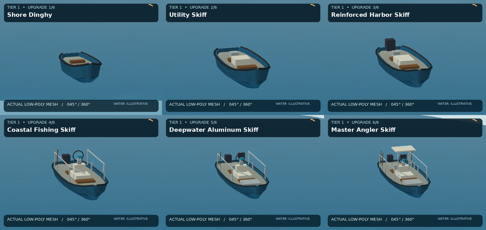

| Stage | Physical hull variant | 360° animation |
|:---:|---|---|
| 1/6 | Shore Dinghy | [View 360° GIF](tier1_00_360.gif) |
| 2/6 | Utility Skiff | [View 360° GIF](tier1_01_360.gif) |
| 3/6 | Reinforced Harbor Skiff | [View 360° GIF](tier1_02_360.gif) |
| 4/6 | Coastal Fishing Skiff | [View 360° GIF](tier1_03_360.gif) |
| 5/6 | Deepwater Aluminum Skiff | [View 360° GIF](tier1_04_360.gif) |
| 6/6 | Master Angler Skiff | [View 360° GIF](tier1_05_360.gif) |

Show all six Tier 1 animated turntables

| Stage | Animated geometry |
|---|---|
| **1/6 · Shore Dinghy** | 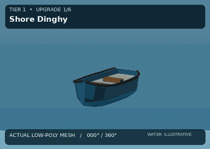 |
| **2/6 · Utility Skiff** | 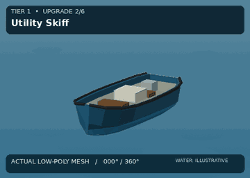 |
| **3/6 · Reinforced Harbor Skiff** | 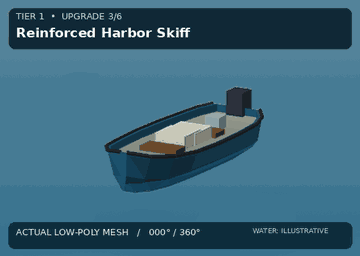 |
| **4/6 · Coastal Fishing Skiff** | 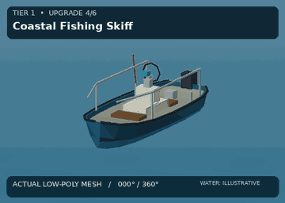 |
| **5/6 · Deepwater Aluminum Skiff** | 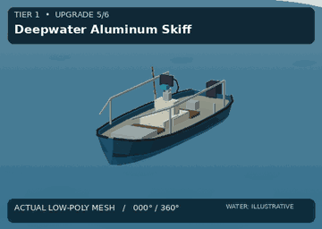 |
| **6/6 · Master Angler Skiff** | 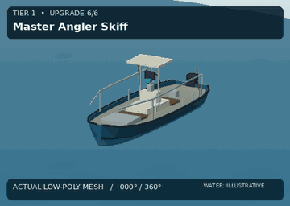 |

## Tier 2 — Coastal Fishing Boats

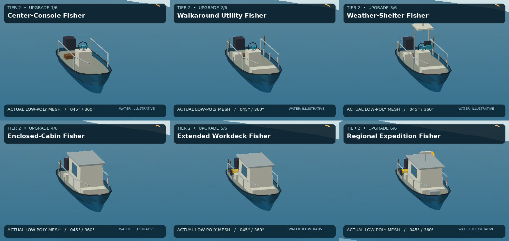

| Stage | Physical hull variant | 360° animation |
|:---:|---|---|
| 1/6 | Center-Console Fisher | [View 360° GIF](tier2_00_360.gif) |
| 2/6 | Walkaround Utility Fisher | [View 360° GIF](tier2_01_360.gif) |
| 3/6 | Weather-Shelter Fisher | [View 360° GIF](tier2_02_360.gif) |
| 4/6 | Enclosed-Cabin Fisher | [View 360° GIF](tier2_03_360.gif) |
| 5/6 | Extended Workdeck Fisher | [View 360° GIF](tier2_04_360.gif) |
| 6/6 | Regional Expedition Fisher | [View 360° GIF](tier2_05_360.gif) |

Show all six Tier 2 animated turntables

| Stage | Animated geometry |
|---|---|
| **1/6 · Center-Console Fisher** | 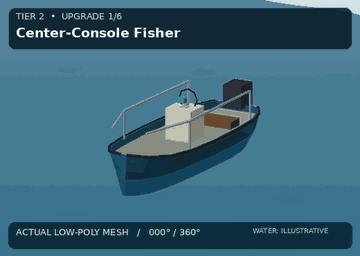 |
| **2/6 · Walkaround Utility Fisher** | 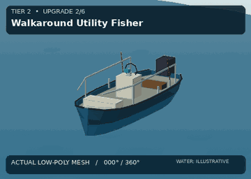 |
| **3/6 · Weather-Shelter Fisher** | 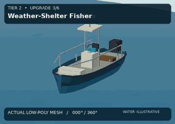 |
| **4/6 · Enclosed-Cabin Fisher** | 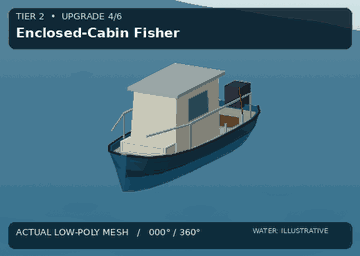 |
| **5/6 · Extended Workdeck Fisher** | 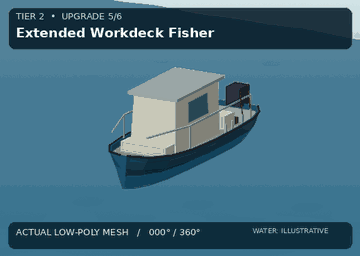 |
| **6/6 · Regional Expedition Fisher** | 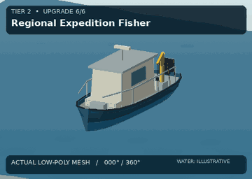 |

## Tier 3 — Commercial Crab Boats

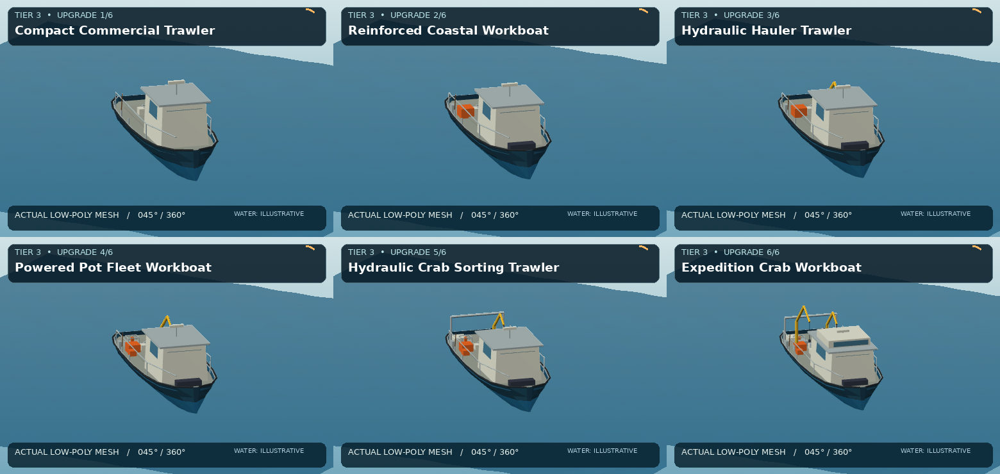

| Stage | Physical hull variant | 360° animation |
|:---:|---|---|
| 1/6 | Compact Commercial Trawler | [View 360° GIF](tier3_00_360.gif) |
| 2/6 | Reinforced Coastal Workboat | [View 360° GIF](tier3_01_360.gif) |
| 3/6 | Hydraulic Hauler Trawler | [View 360° GIF](tier3_02_360.gif) |
| 4/6 | Powered Pot Fleet Workboat | [View 360° GIF](tier3_03_360.gif) |
| 5/6 | Hydraulic Crab Sorting Trawler | [View 360° GIF](tier3_04_360.gif) |
| 6/6 | Expedition Crab Workboat | [View 360° GIF](tier3_05_360.gif) |

Show all six Tier 3 animated turntables

| Stage | Animated geometry |
|---|---|
| **1/6 · Compact Commercial Trawler** | 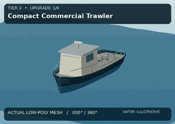 |
| **2/6 · Reinforced Coastal Workboat** | 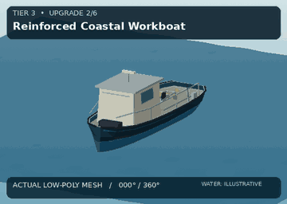 |
| **3/6 · Hydraulic Hauler Trawler** | 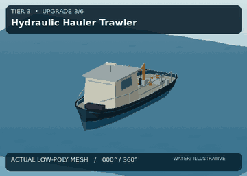 |
| **4/6 · Powered Pot Fleet Workboat** | 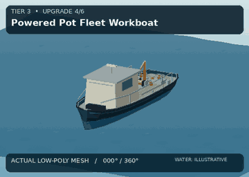 |
| **5/6 · Hydraulic Crab Sorting Trawler** | 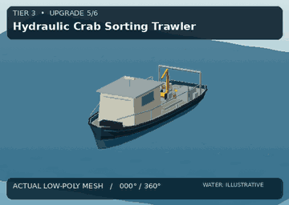 |
| **6/6 · Expedition Crab Workboat** | 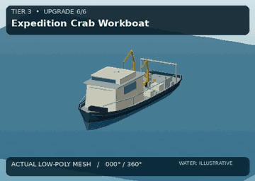 |

## Development record and review gates

- **2026-11-05:** Shaped hull station profiles, deck insets, mounts and review geometry regenerated; see [hull refinement commit](https://github.com/mrcalzon02/ReverieVR/commit/7e0137a700c342e0c1fb8d76fbb48e6f85a0b431).
- **2026-11-05:** The navigation scenarios test turns, draft, bow/stern/beam checks and synthetic 20-minute cruises; this **does not verify real-world navigational safety**.
- **Review outstanding:** native boat mesh replacement, deck navigation/collision, buoyancy presentation, wake visuals, crab pot deployment rigs and FPS on S9.
- **Provenance:** `gallery.json` includes source commit, each image SHA-256, exact size, and 24-frame count; CI verifies every asset and gallery reference.
- **Distribution rights:** project-origin reference assets; confirm rights against the repository asset registry before distribution beyond this project.