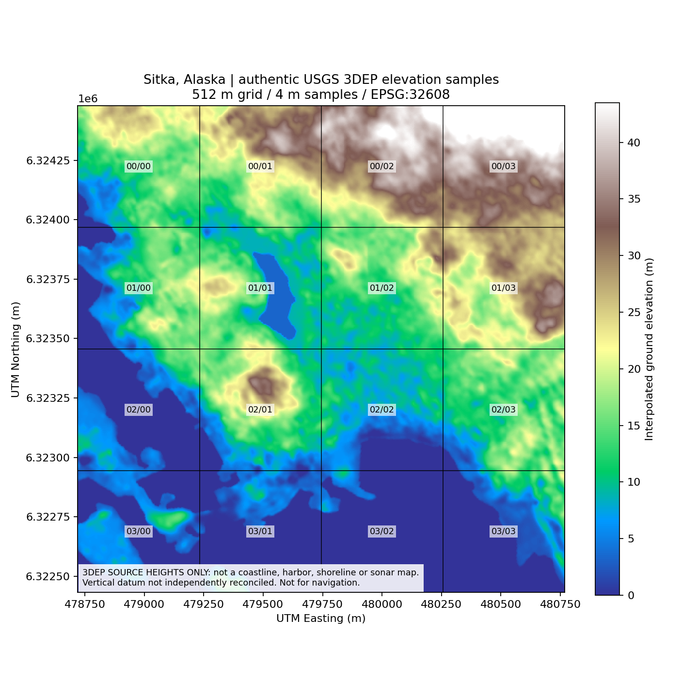

# Sitka — genuine tiled geography proof (November 13, 2026)

**These are actual numeric USGS 3DEP elevation samples, not synthesized terrain or an in-game screenshot.**

Original preview and [all sixteen tiled GeoTIFFs](https://github.com/mrcalzon02/ReverieVR/tree/main/data/sitka/geography/generated/downtown-3dep-v1) are retained with source and tile SHA-256 hashes. 4×4 tiles, each 512×512 m, 4 m sample grid, one shared row/column on every neighboring edge. This illustration is derived only from the verified USGS raster and labels all tile rows/columns.

The colored areas are interpolated elevation values — **not** confirmed shoreline, NOAA bathymetry, roads, buildings, playable terrain or navigation data. No coastal boundary was invented. Reference and blockers: [Sitka GIS tiling and acquisition report](../../../../project/SITKA_GIS_TILING.md).
