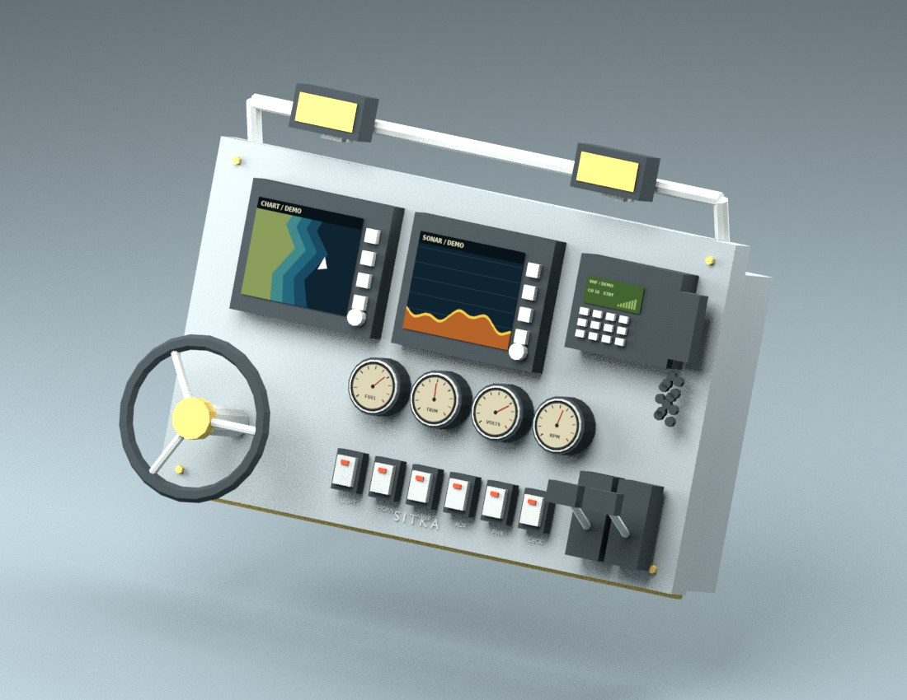

# Sitka maximum helm primitive blockout — 2026-11-07

Status: authored physical asset and offline animation verified; no native integration or device acceptance.

The owner directed maximum-state-first console construction from the approved maximum-helm concept, using cubes/cylinders and animated gauge textures. The actual editable Blender scene and static GLB are in [art/source/sitka/helm/maximum-v1/](../../art/source/sitka/helm/maximum-v1/). The source recipes create the same 99 mesh components / 2,454 triangles, four shallow cylindrical gauges with texture-only needles, independent bezel buttons, switches, wheel, twin throttle levers, VHF and work-light rail. Plate width 1.72 m is a study dimension, not an accepted vessel fit.

Local Blender 4.3.2 build/export/render passed. The saved Blender scene was reopened: all external texture paths resolve; frame 1 uses CHART/SONAR and frame 8 RADAR/CAMERA. Twenty-four actual model frames and twenty-four gauge atlases were generated. The GLB header, declared byte length and mesh table passed inspection. The GLB is a static snapshot; Blender owns the offline sequence demonstration. Python source compilation passed.

Illustrative chart, sonar, radar, camera and radio displays are labeled DEMO. They are not actual Sitka readings or geographic evidence. This scene is an asset review outside the application. Bezel buttons carry proposed action metadata; native behavior, telemetry, power/fitting ownership, hit-testing, purchase/save, hull-specific mounting, reach and headset acceptance remain open. No APK, GitHub Actions or playable-console claim. The trim gauge is retained from the approved reference but has no verified current runtime signal.

Source base: main 05b5fa5a6f8f6d7c80a570e39bff0f1433a9c024. Existing runtime and journal were left untouched. Next: map this approved maximum physical assembly onto existing native helm fittings and implement the actual control/instrument bindings before lower-rank reduction.
